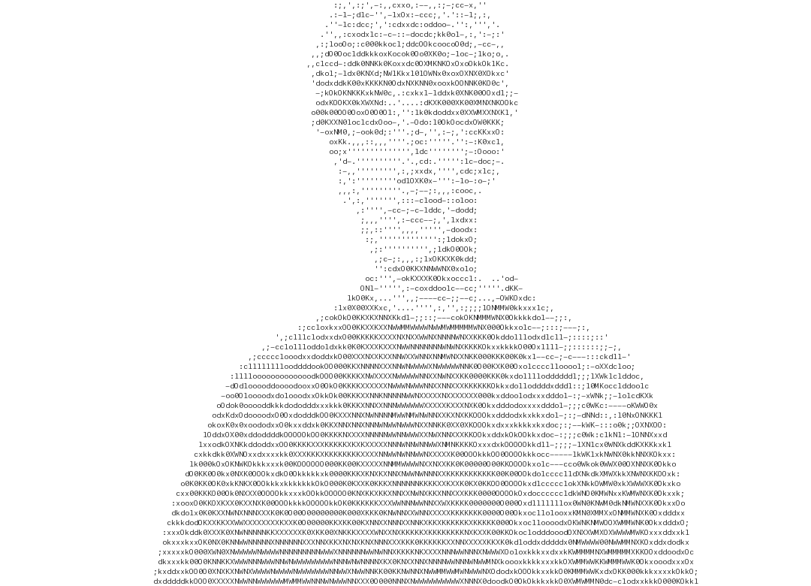

<!--
  github.com/lombazz — profile README
-->

<picture>
  <source media="(prefers-color-scheme: dark)" srcset="assets/ascii-dark.gif">
  
</picture>

<p align="center">
<a href="https://www.linkedin.com/in/alessandro-lombardo-/"></a>
<a href="https://x.com/lombazzzz"></a>
</p>

### `~ about me`

```console
alessandro@lombazz:~$ whoami
→ Alessandro Lombardo · GTM Engineer

alessandro@lombazz:~$ cat ./now.md
→ Building the GTM stack at Augment
→ Scaled it from 100k → 2.5M monthly revenue

alessandro@lombazz:~$ ls ./off-the-clock
🇮🇹 italian   🥊 muay-thai-fighter   🔭 vc-scout   🎂 21

alessandro@lombazz:~$ echo $STATUS
→ shipping automations > writing slides ▌
```
